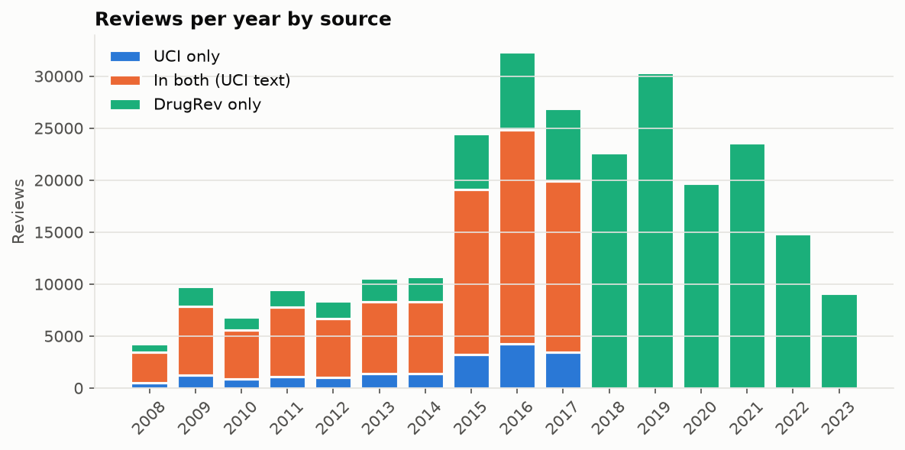
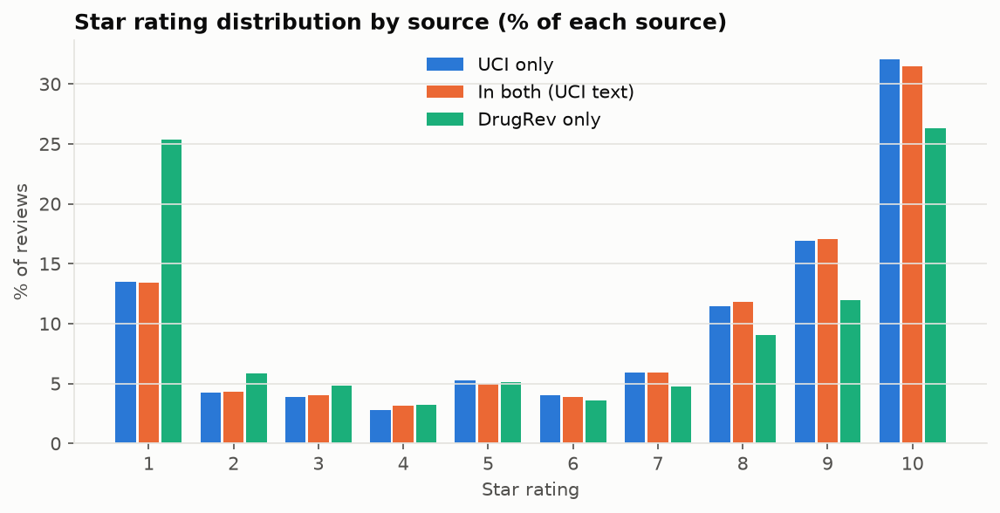
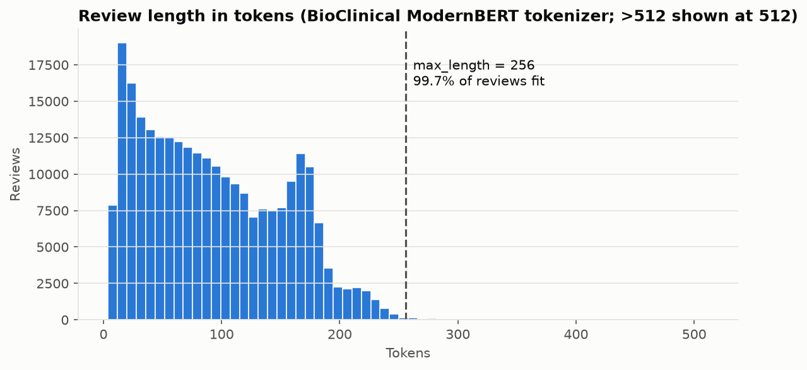
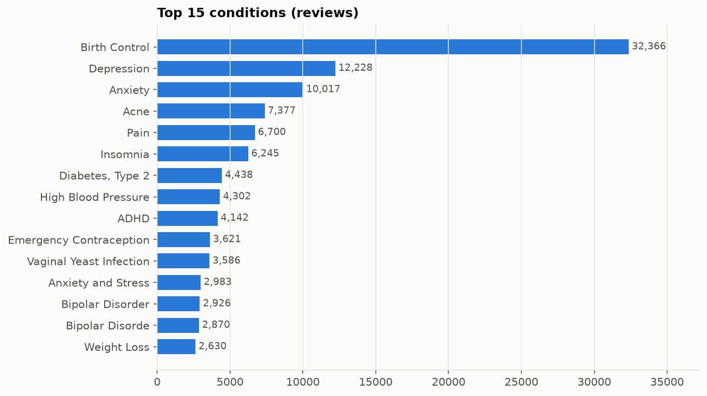
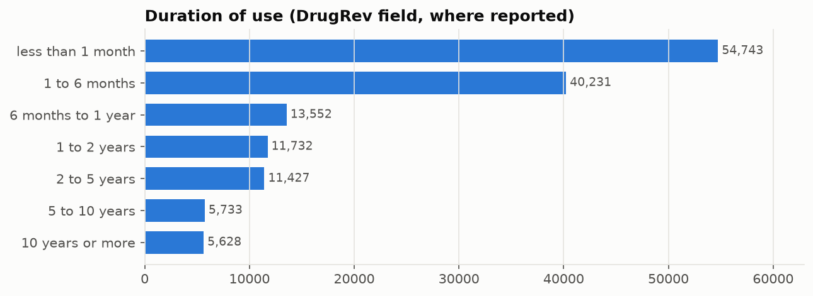

# Data overview (generated)

> Generated by `uv run python -m medsignal.data.eda`. Do not edit by hand; numbers come from `summary.json`.
> Commit `c28b2ac-dirty`, built 2026-10-13T07:08:03+00:00.

## Corpus

| | |
|---|---|
| Reviews (de-duplicated) | 263,862 |
| By source | UCI only 18,534 · in both 93,222 · DrugRev only 152,106 |
| Date range | 2008-02-24 to 2023-08-07 |
| Drug names / drug groups | 3,613 / 1,592 |
| Reviews with a condition | 261,195 (4,509 distinct) |
| Duration of use known | 54.2% |
| Possibly truncated (DrugRev only) | 57.6% |

DrugRev adds the 2018-2023 reviews; the UCI file ends in 2017.

## Ratings

## Length

Tokenizer `thomas-sounack/BioClinical-ModernBERT-base`: median 84 tokens, p95 192, p99 231, max 2349. **99.7% of reviews fit in `max_length=256`.**

## Conditions and duration

## Splits (ADR-0013)

| train | val | test | drug_holdout |
|---|---|---|---|
| 189,938 | 23,743 | 23,743 | 26,438 |
